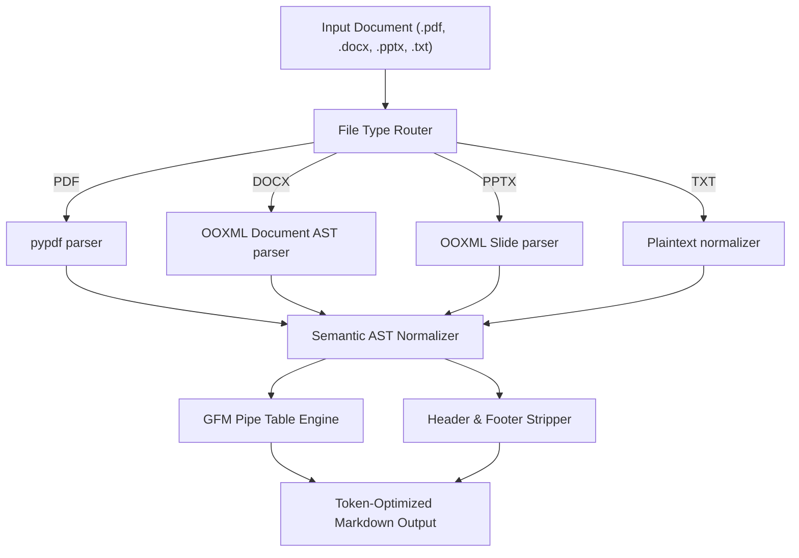

# doc2md-cli

[](https://pypi.org/project/doc2md-cli/)
[](https://pypi.org/project/doc2md-cli/)
[](https://github.com/uchiha-fire/doc2md-cli)
[](LICENSE)
[](https://zephyrus-labs.tech/)

A universal multi-format document to token-optimized GitHub-Flavored Markdown converter (PDF, Word DOCX, PowerPoint PPTX, TXT) engineered for LLM agents, RAG pipelines, and prompt context windows by **[Zephyrus Labs](https://zephyrus-labs.tech/)** for Linux, macOS, and Windows.

---

## Features

- 📑 **Multi-Format Ingestion**: Converts PDF, Word (`.docx`), PowerPoint (`.pptx`), and plain text (`.txt`, `.log`, `.csv`) into clean GitHub Flavored Markdown.
- 📊 **Table Structure Preservation**: Formats document tables into clean GFM pipe tables (`| col1 | col2 |`) with high LLM comprehension accuracy.
- ✂️ **Boilerplate & Noise Stripper**: Automatically detects and prunes repetitive top headers, running footers, and page numbers across multi-page documents (saving 25%–45% context tokens).
- 🏷️ **Header Hierarchy Normalization**: Detects font and heading styles to generate clean `#`, `##`, `###` headings.
- 🧮 **LLM Token Estimator**: Reports total word count and estimated tokens (~4 characters per token).
- 📦 **Smart Bounded Chunking**: Splits large documents into token-friendly chunks bounded by natural paragraph breaks (`--chunk-size`).
- 🤖 **CI/CD & Agent Ready**: Support for `--json` output and an interactive terminal wizard.

---

## Architecture



---

## Installation

```bash
pip install doc2md-cli
```

Or install the latest development build directly:

```bash
pip install git+https://github.com/uchiha-fire/doc2md-cli.git
```

---

## Interactive Mode

Run `doc2md` without positional arguments or pass `--interactive` to launch the terminal wizard:

```bash
doc2md
```

```text
╔══════════════════════════════════════════════════════════════╗
║               doc2md-cli  v0.1.0                             ║
║     Universal Document to LLM-Optimized Markdown             ║
║     Zephyrus Labs (https://zephyrus-labs.tech/)              ║
╚══════════════════════════════════════════════════════════════╝

Welcome to the doc2md Interactive Converter Wizard!

Enter path to document (PDF, DOCX, PPTX, TXT): research_paper.pdf

Select Output Mode:
  [1] Print Markdown to terminal (stdout)
  [2] Save Markdown to file [Default]
  [3] Output JSON payload with token stats
Choose [1/2/3] (default: 2): 2

Enter output markdown path (default: research_paper.md): research_paper.md
Format tables into Markdown pipe tables? [Y/n]: y
Strip repetitive header/footer boilerplate? [Y/n]: y
Split into LLM chunk size in chars (optional, press Enter to skip): 

Converting document to token-optimized Markdown...

Document Conversion Summary:
-----------------------------------------------------------------
  Source Format:     PDF
  Pages / Slides:    18
  Total Words:       6,450
  Estimated Tokens:  ~8,210 tokens
  Saved To:          research_paper.md
-----------------------------------------------------------------

✓ Successfully converted and saved!
```

---

## CLI Usage & Options

```bash
# Convert a PDF and print Markdown to terminal
doc2md paper.pdf

# Convert Word document to a markdown file
doc2md document.docx -o output.md

# Convert PowerPoint slides into chunked sections (2500 chars each)
doc2md presentation.pptx -o slides.md -c 2500

# Output machine-readable JSON for RAG ingest pipelines
doc2md document.pdf --json > rag_payload.json
```

### Options Reference

| Flag | Long Option | Default | Description |
| :--- | :--- | :--- | :--- |
| `input` | *(positional)* | None | Path to input document (`.pdf`, `.docx`, `.pptx`, `.txt`) |
| `-o` | `--output` | stdout | Target output Markdown file path |
| `-t` | `--no-tables` | `False` | Disable pipe table formatting |
| `-c` | `--chunk-size` | None | Split output into bounded character chunks |
| `-j` | `--json` | `False` | Output JSON payload with metadata and tokens |
| `-q` | `--quiet` | `False` | Suppress summary messages |
| `-i` | `--interactive` | `False` | Launch interactive configuration wizard |
| `-v` | `--version` | — | Display package version |

---

## Python API Reference

```python
from doc2md import convert_to_markdown, DocumentResult

# Convert document directly in Python
result: DocumentResult = convert_to_markdown(
    file_path="financial_report.pdf",
    extract_tables=True,
    strip_boilerplate=True,
    chunk_size=2000
)

print(f"Format: {result.format}, Pages: {result.total_pages}")
print(f"Estimated Tokens: {result.estimated_tokens}")
print(result.markdown_text)

# Access bounded chunks for LLM context windows
if result.chunks:
    for idx, chunk in enumerate(result.chunks):
        print(f"--- Chunk {idx + 1} ({len(chunk)} chars) ---")
```

---

## Developed & Maintained by Zephyrus Labs

Built and maintained by **[Zephyrus Labs](https://zephyrus-labs.tech/)**.

- 🌐 Website: [zephyrus-labs.tech](https://zephyrus-labs.tech/)
- 💻 GitHub: [@uchiha-fire](https://github.com/uchiha-fire)
- ✉️ Contact: [zephyrus.labs@gmail.com](mailto:zephyrus.labs@gmail.com)

If you find this tool helpful, please give it a ⭐️ on [GitHub](https://github.com/uchiha-fire/doc2md-cli)!

---

## Acknowledgements & Attributions

This tool builds upon and credits the exceptional work of open-source projects:

- **[pypdf](https://github.com/py-pdf/pypdf)**: Pure Python PDF extraction library. Licensed under BSD-3-Clause.

---

## License

This project is licensed under the MIT License - see the [LICENSE](LICENSE) file for details.

---

<p align="right">
  <sub>Lead Developer: <a href="https://www.linkedin.com/in/shubham-sharma-28487819b/">Shubham Sharma</a> (<a href="https://github.com/uchiha-fire">@uchiha-fire</a>) &bull; <a href="mailto:sharmashubham25962@gmail.com">sharmashubham25962@gmail.com</a></sub>
</p>
